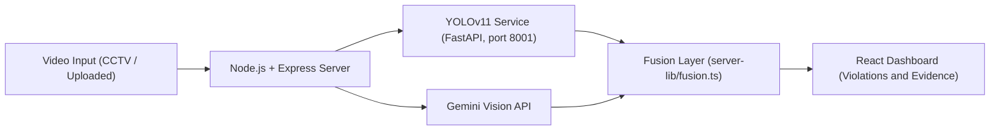

<div align="center">

# 🚦 Vigilant Traffic

### AI-Powered Real-Time Traffic Violation Detection System

*Making roads safer, one frame at a time.*

<br/>


</div>

---

## 📖 Table of Contents

- [About the Project](#-about-the-project)
- [Key Features](#-key-features)
- [Tech Stack](#-tech-stack)
- [System Architecture](#-system-architecture)
- [Getting Started](#-getting-started)
- [Usage](#-usage)
- [Project Structure](#-project-structure)
- [Roadmap](#-roadmap)
- [Screenshots](#-screenshots)
- [Contributing](#-contributing)
- [License](#-license)
- [Contact](#-contact)

---

## 🎯 About the Project

**Vigilant Traffic** is a computer-vision-based traffic violation detection system that identifies common road-safety violations from video footage. It pairs a custom-trained **YOLOv11** detection service with **Gemini Vision** reasoning and a modern, data-rich web dashboard, giving traffic authorities and researchers a fast, accurate way to flag violations without manual monitoring.

Built as a final-year engineering project with a focus on practical deployability: a dedicated inference service, a fusion layer that combines detector outputs, and an intuitive dashboard for reviewing evidence.

---

## ✨ Key Features

| Violation Type | Description |
|---|---|
| 🪖 **Helmet Detection** | Flags two-wheeler riders not wearing a helmet |
| 👥 **Triple Riding** | Detects more than two people on a two-wheeler |
| 🔒 **Seat Belt Detection** | Identifies drivers/passengers without a seat belt |
| 🪞 **Rearview Mirror Check** | Flags vehicles missing rearview mirrors |

**Plus:**

- ⚡ Real-time inference on video input
- 🧠 Hybrid detection: custom YOLOv11 models + Gemini Vision, merged by a fusion layer
- 📊 Interactive dashboard with violation analytics
- 🖼️ Auto-captured evidence frames for each flagged violation
- 🌐 Clean, responsive UI built with React + TypeScript

---

## 🛠️ Tech Stack

| Layer | Technologies |
|---|---|
| **Detection** | YOLOv11 (custom-trained), Gemini Vision API |
| **Inference Service** | Python, FastAPI, Uvicorn |
| **API / Server** | Node.js, Express, TypeScript |
| **Frontend** | React, TypeScript, Tailwind CSS |

**About the YOLOv11 models:** trained on a merged dataset of **5,619 images** across **6 violation classes** for **100 epochs** (Roboflow + PyTorch, GTX 1650). Two weights are included:

- `traffic_best.pt`: helmet, triple riding and seat belt detection
- `mirror_best.pt`: rearview mirror detection

---

## 🏗️ System Architecture



1. The video is sent to the Express server.
2. The server queries the **YOLOv11 FastAPI service** and **Gemini Vision**.
3. The **fusion layer** merges both results into final violation decisions.
4. The **dashboard** displays flagged violations with snapshots, type and timestamp.

---

## 🚀 Getting Started

### Prerequisites

- [Node.js](https://nodejs.org/) v18+
- [Python](https://www.python.org/) 3.9+
- A [Gemini API key](https://aistudio.google.com/app/apikey)

### 1. Clone the repository

```bash
git clone https://github.com/himeshss6105/Vigilant-Traffic-Violation-Detection.git
cd Vigilant-Traffic-Violation-Detection
```

### 2. Install dependencies

```bash
# Web app / server
npm install

# YOLOv11 inference service
cd yolo-service
python -m venv venv
venv\Scripts\activate          # Windows
# source venv/bin/activate     # macOS / Linux
pip install -r requirements.txt
cd ..
```

### 3. Configure environment variables

Create a `.env.local` file in the project root (use `.env.example` as a template):

```env
GEMINI_API_KEY=your_gemini_api_key_here
```

> ⚠️ Never commit your real API key. `.env.local` should stay in `.gitignore`.

---

## ▶️ Usage

> **Important:** start the **YOLOv11 service first**. The app depends on it for detection.

### Step 1: Start the YOLOv11 service

```bash
cd yolo-service
python -m uvicorn main:app --port 8001
```

Keep this terminal running. The service is ready when Uvicorn reports it is running on `http://127.0.0.1:8001`.

### Step 2: Start the app

Open a **new terminal** in the project root:

```bash
npm run dev
```

Then open the local URL printed in the terminal.

### Using the dashboard

1. Upload a traffic video clip (or connect a live feed, see the [Roadmap](#-roadmap))
2. The pipeline analyzes each frame for violations
3. Flagged violations appear on the dashboard with a snapshot, violation type and timestamp
4. Review the evidence directly from the UI

---

## 📂 Project Structure

```
Vigilant-Traffic-Violation-Detection/
├── src/                      # React + TypeScript frontend
│   ├── components/
│   │   ├── Dashboard.tsx     # Violations dashboard
│   │   └── Presentation.tsx  # Project presentation view
│   ├── App.tsx
│   └── data.ts
├── server-lib/
│   └── fusion.ts             # Fuses YOLOv11 + Gemini results
├── yolo-service/             # YOLOv11 FastAPI inference service
│   ├── main.py
│   ├── requirements.txt
│   ├── traffic_best.pt       # Helmet / triple riding / seat belt model
│   └── mirror_best.pt        # Rearview mirror model
├── server.ts                 # Express API server
├── .env.example
└── package.json
```

---

## 🗺️ Roadmap

**Completed**

- [x] Helmet detection
- [x] Triple riding detection
- [x] Seat belt detection
- [x] Rearview mirror detection
- [x] React + TypeScript dashboard
- [x] Custom **YOLOv11** training on a merged dataset (5,619 images, 100 epochs)
- [x] FastAPI inference service to serve the trained weights
- [x] YOLOv11 + Gemini fusion layer integrated into the Express stack

**Planned**

- [ ] 📹 Live CCTV feed integration for real-time monitoring
- [ ] 🔔 Real-time alert notifications for authorities
- [ ] 🚗 Number plate recognition for automatic violation ticketing
- [ ] ☁️ Cloud deployment for multi-camera, city-wide monitoring
- [ ] 📱 Mobile companion app for field officers

---

## 📸 Screenshots

<div align="center">


<br/><br/>


<br/><br/>


<br/><br/>


</div>

---

## 🤝 Contributing

Contributions, issues and feature requests are welcome!

1. Fork the project
2. Create your feature branch (`git checkout -b feature/amazing-feature`)
3. Commit your changes (`git commit -m "Add some amazing feature"`)
4. Push to the branch (`git push origin feature/amazing-feature`)
5. Open a Pull Request

---

## 📄 License

This project is licensed under the MIT License. See the `LICENSE` file for details.

---

## 📬 Contact

**Himesh**
Final Year B.E. — Artificial Intelligence & Machine Learning
Jyothy Institute of Technology, Bangalore

<div align="center">

⭐ *If you found this project useful, consider giving it a star!* ⭐

</div>
